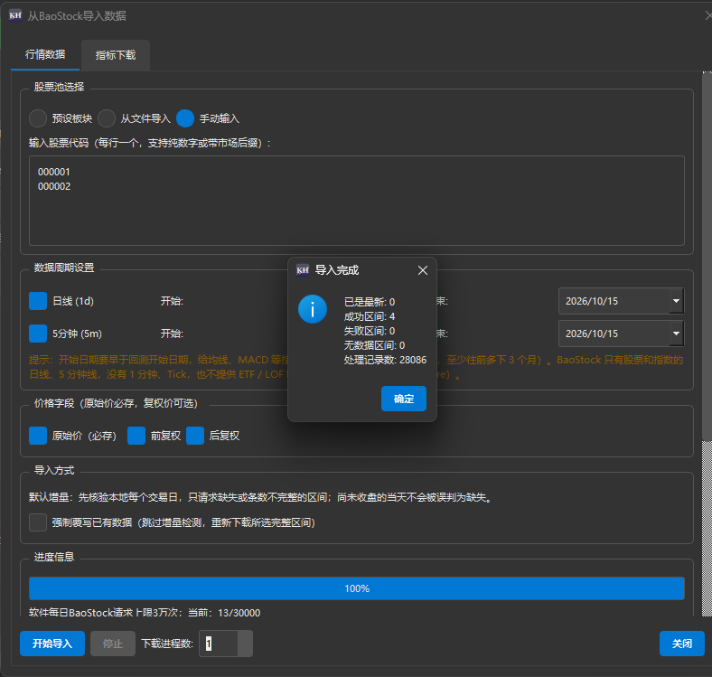

<p align="center">
  
</p>

<h1 align="center">看海量化回测平台 · 开源版</h1>

<p align="center">
  <b>一个想法，二十行 Python，一份完整的回测报告。</b><br>
  免费开源的 A 股量化回测桌面软件——不用开户，不用装 QMT，下载即用。
</p>

<p align="center">
  <a href="https://github.com/khscience/OSkhQuant/releases/latest"></a>
  
  
  <a href="LICENSE"></a>
  <a href="https://github.com/khscience/OSkhQuant/releases"></a>
  <a href="https://github.com/khscience/OSkhQuant/stargazers"></a>
</p>

<p align="center">
  <a href="https://github.com/khscience/OSkhQuant/releases/latest"><b>⬇️ 下载安装包</b></a>
  &nbsp;·&nbsp;
  <a href="https://khsci.com/khQuant/quickstart/"><b>▶️ 3 分钟上手视频</b></a>
  &nbsp;·&nbsp;
  <a href="https://khsci.com/khQuant/tutorial/">📖 完整教程</a>
  &nbsp;·&nbsp;
  <a href="CHANGELOG.md">📝 更新记录</a>
  &nbsp;·&nbsp;
  <a href="https://gitee.com/mrkanhai/oskhquant">🇨🇳 Gitee 镜像</a>
</p>

<p align="center">
  
</p>

---

## ✨ 为什么用它

想验证一个交易想法，往往要先凑数据、再搭框架、再自己算收益和回撤——事情还没开始，精力已经耗掉一半。
看海量化把这些都替你做好了：

<table>
<tr>
<td width="33%" valign="top">

### 🆓 数据免费
BaoStock 不用注册，日线和 5 分钟线直接下；有 Tushare 权限还能下 1 分钟线、ETF、可转债。数据存在你自己电脑上的 DuckDB 里。

</td>
<td width="33%" valign="top">

### ✍️ 策略就一个文件
实现 `init` 和 `khHandlebar` 两个函数就能跑。`khHistory`、`khMA` 取数算指标，内置 MyTT 指标库和缠论工具。

</td>
<td width="33%" valign="top">

### 📊 报告一键生成
收益与基准对比、回撤、每日盈亏、买卖分布；夏普、索提诺、胜率、盈亏比；个股 K 线上标出每一笔买卖。

</td>
</tr>
<tr>
<td valign="top">

### ⚖️ 按 A 股规则撮合
T+0 / T+1、佣金、印花税、过户费、滑点、成交量限制都算进去；Tick、1 分钟、5 分钟、日线四种触发周期。

</td>
<td valign="top">

### 🔬 和 V3 同一个内核
回测内核与 V3.4.1.10 相同，每次发版前用冻结数据逐笔核对成交、费用和收益。以后想升级，策略直接搬过去。

</td>
<td valign="top">

### 🚀 新手四步跑通
首次打开自动引导选数据目录、下载沪深300基准，再弹出「新手上手」，四步跑出第一个回测。

</td>
</tr>
</table>

## 🚀 30 秒看懂怎么用

<p align="center">
  <b>下载数据</b> &nbsp;➜&nbsp; <b>写策略</b> &nbsp;➜&nbsp; <b>点「开始运行」</b> &nbsp;➜&nbsp; <b>看报告</b>
</p>

一个完整的双均线策略，去掉注释就是这么多：

```python
from khQuantImport import *

def init(stocks=None, data=None):
    pass

def khHandlebar(data):
    code = khGet(data, "first_stock")
    price = khPrice(data, code, "open")
    today = khGet(data, "date_num")
    try:
        ma5, ma20 = khMA(code, 5, end_time=today), khMA(code, 20, end_time=today)
    except ValueError:                              # 预热期数据不够，先跳过
        return []

    if ma5 > ma20 and not khHas(data, code):        # 金叉，空仓 → 买入
        return generate_signal(data, code, price, 1.0, "buy", "5日线上穿20日线")
    if ma5 < ma20 and khHas(data, code):            # 死叉，持仓 → 卖出
        return generate_signal(data, code, price, 1.0, "sell", "5日线下穿20日线")
    return []
```

随包附带 4 个示例策略（双均线 3 个、RSI 1 个），可以照着改。

## ⬇️ 下载安装

| 下载地址 | 说明 |
| :--- | :--- |
| **[GitHub Releases](https://github.com/khscience/OSkhQuant/releases/latest)** | 下载 `khQuantOS_Setup_V2.x.x.exe` |
| **[Gitee 发行版](https://gitee.com/mrkanhai/oskhquant/releases)** | 国内访问更快，文件与 GitHub 相同 |

- 系统要求：Windows 10 / 11 64 位。同页的 `SHA256SUMS.txt` 可以用来核对文件。
- 首次运行如出现「Windows 已保护你的电脑」：安装包没有付费数字签名（开源项目普遍如此），点「更多信息」→「仍要运行」即可。
- 已经装了 V2.1？可以同时保留，程序、设置、数据、日志各用各的。升级前建议先看 [从 V2.1 迁移](docs/从V2.1迁移.md)。

## 🧭 第一次使用

打开软件先进入「首次启动引导」：选一个数据目录（建议放在非系统盘），勾选用 BaoStock 下载沪深300日线作为基准。装过 V2.1 的话，还可以顺手只读导入它的设置。
引导结束后，如果本机还没有股票行情，会弹出「新手上手」：

<p align="center">
  
</p>

1. **下载数据**：「数据管理 → BaoStock导入」，填股票代码，下载日线。开始日期要早于回测开始日期，给均线留出预热期。
2. **加载示例**：工具栏「加载配置」，选一个示例策略（在 `文档\KhQuant_OS\strategies`）。
3. **添加股票**：示例的股票池是空的，在左侧「股票池设置」点「添加股票」，填刚才下载的股票，再「保存配置」。
4. **开始运行**：回测区间放在已下载的数据范围内，点「开始运行」，看报告。

跟着视频做一遍更快：[3 分钟快速上手](https://khsci.com/khQuant/quickstart/)。之后随时可从工具栏「?」→「新手上手（视频教程）」再打开。

## 🗂️ 数据来源

<p align="center">
  
</p>

| 周期 | BaoStock（免费） | Tushare（需 Token） |
| :--- | :---: | :--- |
| 日线 | ✅ 不用账号 | ✅ 复权价约需 2000 积分 |
| 5 分钟 | ✅ | ✅ 需分钟权限 |
| 1 分钟 | — | ✅ 股票 `stk_mins`、ETF `etf_mins` |
| 指数 | ✅ 日线 | 日线（基准默认 000300.SH） |
| ETF / LOF 等场内基金 | — | 日线 `fund_daily`；ETF 分钟 `etf_mins` |
| 可转债 | — | `cb_daily` 不复权日线 |
| Tick | — | —（需自行导入 DuckDB） |

<details>
<summary><b>数据细节说明（点开查看）</b></summary>

- BaoStock 在软件内每天最多用 3 万次请求，「数据管理」状态栏会显示当天已用次数。增量下载前复权数据时，会把本地整段历史重新拉一遍；全市场只更新日线大约需要 1.5 万次。
- 新导入 K 线的成交量统一为「手」、成交额为「元」，保留小数手。旧表兼容续写时保留历史原值并记录待核验状态，不会自动缩放旧数据。
- Tushare 的「API 地址」留空即使用官方 HTTPS 接口。使用第三方服务商时，直接填写服务商给的地址，程序会自动识别官方写法或「地址/接口名 + 请求头 X-API-Key」写法；`http://` 地址不提供传输加密。权限、限流和服务端错误会直接报错，只有成功响应的空数据才按 0 条处理。
- K 线时间一律是这根 K 线的**收盘时刻**（5 分钟线 09:35…11:30、13:05…15:00）。服务商按开始时间标注的分钟线会在导入时统一改为收盘时刻；以前按开始时间存进库的分钟数据会在导入时提示，可勾选「强制覆写已有数据」重新下载。
- 同一个 DuckDB 库文件同一时刻只允许一个进程写入；提示数据库被占用时，可在「数据管理 → 占用诊断」里看是哪个程序占着。

</details>

## 🆚 开源版与 V3

开源版已经够用来学习和研究策略；需要更多平台、数据源和自动化时，可以了解 V3。

| | 开源版 2.2 | V3 |
| :--- | :--- | :--- |
| 系统 | Windows | Windows、Apple Silicon macOS 桌面版；Linux 命令行与 Web 工作台 |
| 使用方式 | 图形界面 | 另有 CLI：不开界面也能下数据、回测、看结果，适合批量跑和远程服务器 |
| 数据来源 | BaoStock、Tushare | 另加同花顺（扶摇开放平台）、miniQMT，并持续集成更多数据源 |
| Web 回测 | — | 浏览器里跑回测、看结果，手机也能远程访问 |
| 策略编写 | 用自己的编辑器写 `.py` | Windows 集成 VS Code 启动与断点调试（需自行安装 VS Code） |
| 数据维护 | 手动下载、增量补充 | 另有定时自动补充 |
| 策略案例 ※ | 4 个基础案例 | 13 个，另有持续更新的专栏策略案例 |
| 回测内核 | 成交、费用、滑点、T+0 / T+1、复权 | 与开源版 2.2 相同 |

<sub>※ 随包案例的股票池为空，需要自己填写；案例参数中加入了随机数，仅作为写法演示，不构成任何策略或投资建议。2.2.0 与 V3.4.1.10 的六组冻结案例在相同数据、固定参数、相同配置下逐笔一致，但不能据此保证任意配置或随机参数下的结果始终相同。</sub>

👉 [了解 V3 与版本对比](https://khsci.com/khQuant/#version-comparison)

## 🛠️ 开发者

<details>
<summary><b>源码运行、测试与打包</b></summary>

```bash
python -m pip install -r requirements.txt
python GUIkhQuant.py
```

- 需要 Python 3.11（Windows 10/11 64 位）。
- 测试：`python -m pip install pytest`，然后 `python -m pytest tests`。
- 打包：再安装 `requirements-build.lock` 和 Inno Setup 6，运行 `build_inno.bat`，安装包在 `Output\`。
- 本仓库由看海量化主库的构建脚本生成，`PORT_BASE` 记录对应的主库提交。
- 常用接口：`khHistory`、`khKline`、`khMA`、`khPrice`、`khGet`、`khHas`、`khDuckDB`、`khDuckWrite`、MyTT 指标、缠论工具。V2.1 的 `xtdata` 接口在开源版里不可用，调用时会提示改用 `khHistory` 等本地接口。

</details>

<details>
<summary><b>文件都放在哪里（与 V2.1 互不干扰）</b></summary>

| 项目 | 位置 |
| :--- | :--- |
| 程序 | `khQuantOS.exe`，默认 `C:\Program Files\khQuantOS`，开始菜单组 `khQuantOS` |
| 设置 | `~\.khquant_os\settings.json`、注册表 `HKCU\Software\KHQuant\StockAnalyzerOS` |
| 数据 | 默认 `%LOCALAPPDATA%\KhQuantOS\khData` |
| 日志 | `%LOCALAPPDATA%\KhQuantOS\logs` |
| 回测结果 | `%LOCALAPPDATA%\KhQuantOS\backtest_results`（源码运行时在项目目录下） |
| 策略 | `文档\KhQuant_OS\strategies` |

</details>

## 💬 反馈与交流

- 遇到问题或有建议，欢迎提 Issue：[GitHub](https://github.com/khscience/OSkhQuant/issues) · [Gitee](https://gitee.com/mrkanhai/oskhquant/issues)。请附上软件版本、操作步骤和日志（`%LOCALAPPDATA%\KhQuantOS\logs\app.log`）。
- 作者 **Mr.看海** · 微信公众号「看海的城堡」 · [知乎](https://www.zhihu.com/people/feng-zhu-38) · [B站](https://space.bilibili.com/3546667687086777)

**如果这个项目对你有帮助，点个 ⭐ Star 吧**——方便你以后找到它，也能让更多人看到。

<p align="center">
  <a href="https://star-history.com/#khscience/OSkhQuant&Date">
    
  </a>
</p>

## 📄 许可与免责

- 源代码遵循 [CC BY-NC 4.0](LICENSE)（署名-非商业性使用），禁止商业用途。第三方组件见 [THIRD_PARTY_NOTICES.md](THIRD_PARTY_NOTICES.md)。
- 本软件只用于量化编程技术交流和策略研究，不构成任何投资建议。历史回测表现不代表未来收益，投资有风险，入市需谨慎。
