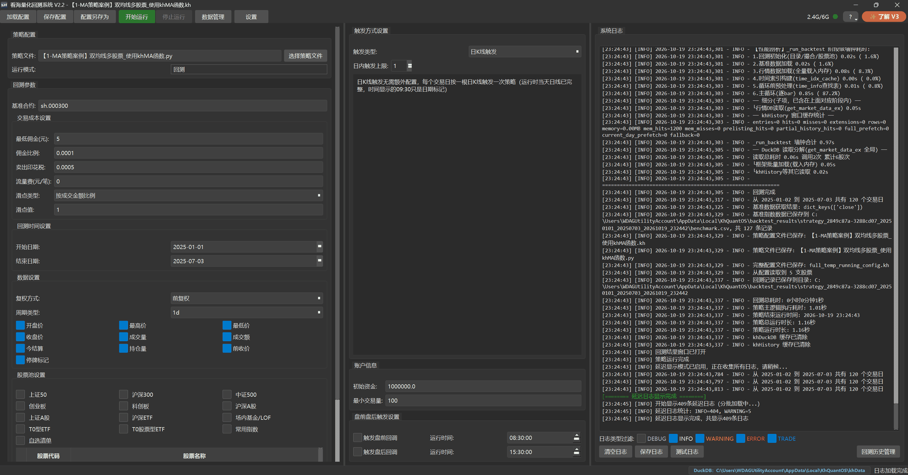
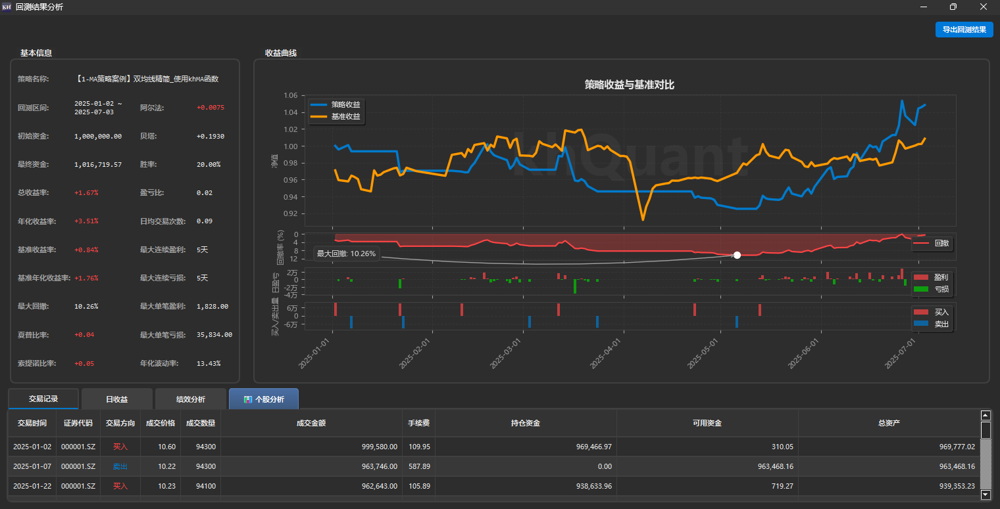
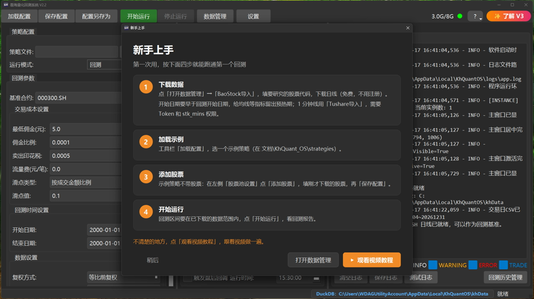
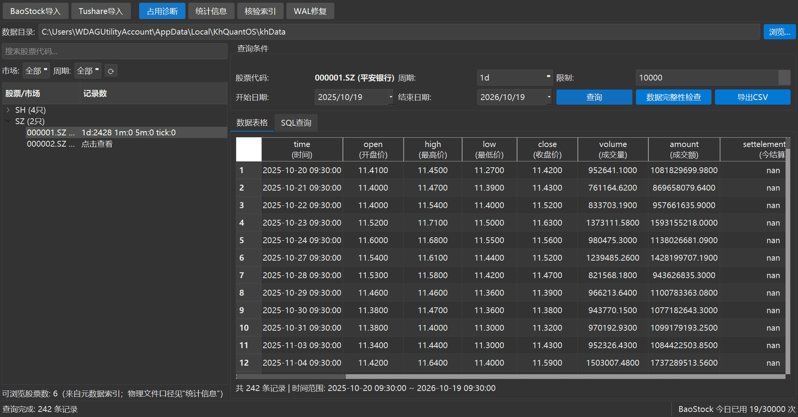

<p align="center">
  
</p>

<h1 align="center">看海量化回测平台 · 开源版</h1>

<p align="center">
  <b>免费开源的 A 股量化回测桌面软件——不用开户，不用装 QMT，下载即用。</b><br>
  下载行情数据 ➜ 写二十行 Python 策略 ➜ 点「开始运行」 ➜ 看完整回测报告。
</p>

<p align="center">
  <a href="https://github.com/khscience/OSkhQuant/releases/latest"></a>
  
  
  <a href="LICENSE"></a>
  <a href="https://github.com/khscience/OSkhQuant/releases"></a>
  <a href="https://github.com/khscience/OSkhQuant/stargazers"></a>
  <a href="https://khsci.com/khQuant/"></a>
</p>

<h3 align="center">🌐 官方网站：<a href="https://khsci.com/khQuant/">https://khsci.com/khQuant/</a></h3>
<p align="center"><sub>安装包下载、图文与视频教程、版本对比、更新公告都在官网</sub></p>

<p align="center">
  <a href="https://github.com/khscience/OSkhQuant/releases/latest"><b>⬇️ 下载安装包 (GitHub)</b></a>
  &nbsp;·&nbsp;
  <a href="https://gitee.com/mrkanhai/oskhquant/releases"><b>🇨🇳 国内下载 (Gitee)</b></a>
  &nbsp;·&nbsp;
  <a href="https://khsci.com/khQuant/quickstart/"><b>▶️ 3 分钟上手视频</b></a>
  &nbsp;·&nbsp;
  <a href="https://khsci.com/khQuant/tutorial/">📖 完整教程</a>
  &nbsp;·&nbsp;
  <a href="CHANGELOG.md">📝 更新记录</a>
</p>

<p align="center">
  
</p>

---

## 💡 为什么做这个工具

个人想验证一个 A 股交易想法，往往还没开始写逻辑，光在找免费数据、申请券商 QMT 权限、搭回测框架、算手续费和回撤上就耗光了精力。

**看海量化开源版 2.2** 把这些琐事都打包好了。它是一个装在 Windows 上的独立桌面软件，这次 2.2 大版本升级彻底去掉了对 QMT / miniQMT 的依赖，装好就能直接拉数据跑回测：

<table>
<tr>
<td width="33%" valign="top">

### 🆓 免费数据直接下
内置 BaoStock，不用注册账号就能下日线和 5 分钟线；有 Tushare 权限还能下 1 分钟线、ETF、可转债。数据存在本机 DuckDB 数据库里，归你自己管。

</td>
<td width="33%" valign="top">

### ✍️ 策略就一个 `.py` 文件
实现 `init` 和 `khHandlebar` 两个函数就能跑。用 `khHistory`、`khMA` 取数算指标，内置了 MyTT 指标库和缠论工具。

</td>
<td width="33%" valign="top">

### 📊 报告自动生成
跑完自动弹出图表：收益与基准对比、回撤曲线、每日盈亏、买卖分布；自动计算夏普、索提诺、胜率、盈亏比；个股 K 线上标出每一笔买卖点。

</td>
</tr>
<tr>
<td valign="top">

### ⚖️ 贴合 A 股交易规则
支持 T+0 / T+1、佣金、印花税、过户费、滑点、成交量限制；支持 Tick、1 分钟、5 分钟、日线四种触发周期。

</td>
<td valign="top">

### 🔬 与 V3 同一个回测内核
回测内核与 V3.4.1.10 相同，每次发版前用冻结数据逐笔核对成交、费用和收益。以后如果升级到 V3，写好的策略可以直接搬过去用。

</td>
<td valign="top">

### 🧭 新手引导四步跑通
首次打开自动引导选数据目录、下载沪深300基准，随后弹出「新手上手」窗口，跟着点四步就能跑出第一份回测报告。

</td>
</tr>
</table>

---

## ⚡ 30 秒看懂怎么用

整个流程只有四步：**下载数据 ➜ 写策略 ➜ 点「开始运行」 ➜ 看报告**。

一个完整的双均线策略，去掉注释就这么多代码：

```python
from khQuantImport import *

def init(stocks=None, data=None):
    pass

def khHandlebar(data):
    code = khGet(data, "first_stock")
    price = khPrice(data, code, "open")
    today = khGet(data, "date_num")
    try:
        ma5, ma20 = khMA(code, 5, end_time=today), khMA(code, 20, end_time=today)
    except ValueError:                              # 预热期数据不够，先跳过
        return []

    if ma5 > ma20 and not khHas(data, code):        # 金叉，空仓 → 买入
        return generate_signal(data, code, price, 1.0, "buy", "5日线上穿20日线")
    if ma5 < ma20 and khHas(data, code):            # 死叉，持仓 → 卖出
        return generate_signal(data, code, price, 1.0, "sell", "5日线下穿20日线")
    return []
```

安装包里自带了 **4 个示例策略**（双均线 3 个、RSI 1 个），可以直接照着改。点「开始运行」，跑完就会弹出下面这样的回测报告：

<p align="center">
  
</p>

---

## ⬇️ 下载与安装

系统要求：**Windows 10 / 11 64 位**。

| 下载渠道 | 说明 |
| :--- | :--- |
| **[GitHub Releases](https://github.com/khscience/OSkhQuant/releases/latest)** | 下载 `khQuantOS_Setup_V2.x.x.exe`（同页附有 `SHA256SUMS.txt` 可供校验文件） |
| **[Gitee 发行版](https://gitee.com/mrkanhai/oskhquant/releases)** | 国内镜像，下载速度更快，安装包与 GitHub 完全相同 |
| **[Gitee 仓库主页](https://gitee.com/mrkanhai/oskhquant)** | 国内代码镜像仓库 |

> **安装提示：**
> - **系统拦截弹窗**：首次运行如果遇到「Windows 已保护你的电脑」，是因为开源项目没有购买付费数字签名，点击「更多信息」→「仍要运行」即可。
> - **老用户共存**：电脑里已经装了旧版 V2.1？**可以同时保留**。2.2 的程序、设置、数据、日志和 V2.1 各用各的，互不干扰。升级前建议看一眼 [从 V2.1 迁移说明](docs/从V2.1迁移.md)。

---

## 🧭 第一次打开怎么做

第一次启动软件会先进入「首次启动引导」：选一个存放行情的目录（建议放非系统盘），勾选用 BaoStock 下载沪深300日线作为基准。如果你以前装过 V2.1，这里还可以顺手只读导入旧版设置。

引导结束后，如果本机还没有股票行情，会自动弹出「新手上手」窗口：

<p align="center">
  
</p>

跟着窗口里的提示做四步就能跑起来：

1. **下载数据**：点「数据管理 → BaoStock导入」，填入股票代码下载日线。注意开始日期要早于回测开始日期，给均线计算留出预热期。
2. **加载示例**：点工具栏「加载配置」，选一个自带的示例策略（存放在 `文档\KhQuant_OS\strategies`）。
3. **添加股票**：示例策略默认的股票池是空的，在主界面左侧「股票池设置」点「添加股票」，填刚才下载的股票代码，再点「保存配置」。
4. **开始运行**：把回测区间设在已下载的数据范围内，点「开始运行」，等待报告弹出。

喜欢看视频的话，跟着 **[3 分钟快速上手视频](https://khsci.com/khQuant/quickstart/)** 操作一遍更快。这个窗口以后随时可以从顶部工具栏「?」→「新手上手（视频教程）」重新打开。

---

## 🗂️ 支持的数据源

软件自带可视化的数据管理窗口，能直接查本地有哪些股票、预览 K 线、看 BaoStock 当天用了多少次请求：

<p align="center">
  
</p>

| 数据品种 / 周期 | BaoStock（免费） | Tushare（需 Token） |
| :--- | :---: | :--- |
| **股票日线** | ✅ 不用注册账号 | ✅ 复权价约需 2000 积分 |
| **5 分钟线** | ✅ | ✅ 需分钟权限 |
| **1 分钟线** | — | ✅ 股票 `stk_mins`、ETF `etf_mins` |
| **指数** | ✅ 日线 | 日线（基准默认 `000300.SH`） |
| **ETF / LOF 等场内基金** | — | 日线 `fund_daily`；ETF 分钟 `etf_mins` |
| **可转债** | — | `cb_daily` 不复权日线 |
| **Tick** | — | —（需自行导入 DuckDB） |

<details>
<summary><b>📌 数据使用细节与注意事项（点此展开）</b></summary>

- **BaoStock 请求额度**：软件内限制每天最多用 3 万次请求，「数据管理」底部状态栏会显示当天已用次数。增量下载前复权数据时，会把本地整段历史重新拉一遍；全市场只更新日线大约需要 1.5 万次。
- **成交量与成交额单位**：新导入 K 线的成交量统一为「手」、成交额为「元」，保留小数手。旧表兼容续写时保留历史原值并记录待核验状态，不会自动缩放旧数据。
- **Tushare 接口与第三方代理**：「API 地址」留空即使用官方 HTTPS 接口。使用第三方服务商时，直接填写服务商给的地址，程序会自动识别官方写法或「地址/接口名 + 请求头 X-API-Key」写法；注意 `http://` 地址不提供传输加密。权限、限流和服务端错误会直接报错，只有成功响应的空数据才按 0 条处理。
- **分钟线时间戳规则**：K 线时间一律是这根 K 线的**收盘时刻**（例如 5 分钟线为 09:35…11:30、13:05…15:00）。服务商按开始时间标注的分钟线会在导入时统一改为收盘时刻；以前按开始时间存进库的分钟数据会在导入时提示，可勾选「强制覆写已有数据」重新下载。
- **数据库文件占用**：同一个 DuckDB 库文件同一时刻只允许一个进程写入；遇到提示数据库被占用时，可在「数据管理 → 占用诊断」里查看是哪个程序占着。

</details>

---

## 🆚 开源版 2.2 与 V3 对比

开源版 2.2 用来日常学习量化、验证策略想法已经够用。如果你需要跨平台、更多数据源、命令行批量回测或自动化功能，可以了解下 V3：

| 对比项 | 开源版 2.2 | V3 |
| :--- | :--- | :--- |
| **操作系统** | Windows | Windows、Apple Silicon macOS 桌面版；Linux 命令行与 Web 工作台 |
| **使用方式** | 图形界面 | 另有 CLI：不开界面也能下数据、回测、看结果，适合批量跑和远程服务器 |
| **数据来源** | BaoStock、Tushare | 另加同花顺（扶摇开放平台）、miniQMT，并持续集成更多数据源 |
| **Web 回测** | — | 浏览器里跑回测、看结果，手机也能远程访问 |
| **策略编写** | 用自己的编辑器写 `.py` | Windows 集成 VS Code 启动与断点调试（需自行安装 VS Code） |
| **数据维护** | 手动下载、增量补充 | 另有定时自动补充 |
| **策略案例** ※ | 4 个基础案例 | 13 个，另有持续更新的专栏策略案例 |
| **回测内核** | 成交、费用、滑点、T+0 / T+1、复权 | 与开源版 2.2 相同 |

<sub>※ 说明：随包案例的股票池为空，需要自己填写；案例参数中加入了随机数，仅作为写法演示，不构成任何策略或投资建议。2.2.0 与 V3.4.1.10 的六组冻结案例在相同数据、固定参数、相同配置下逐笔一致，但不能据此保证任意配置或随机参数下的结果始终相同。</sub>

👉 **[去官网了解 V3 与详细版本对比](https://khsci.com/khQuant/#version-comparison)**

---

## 🛠️ 开发者与进阶信息

<details>
<summary><b>源码运行、单元测试、打包与常用 API（点此展开）</b></summary>

如果你想直接从 Python 源码运行或自己修改代码：

```bash
python -m pip install -r requirements.txt
python GUIkhQuant.py
```

- **环境要求**：Python 3.11（Windows 10/11 64 位）。
- **运行测试**：执行 `python -m pip install pytest`，然后运行 `python -m pytest tests`。
- **构建安装包**：额外安装 `requirements-build.lock` 里的依赖和 Inno Setup 6，运行 `build_inno.bat`，生成的安装包在 `Output\` 目录下。
- **仓库说明**：本仓库由看海量化主库的构建脚本生成，`PORT_BASE` 记录对应的主库提交。
- **常用策略接口**：`khHistory`、`khKline`、`khMA`、`khPrice`、`khGet`、`khHas`、`khDuckDB`、`khDuckWrite`、MyTT 指标、缠论工具。注意 V2.1 的 `xtdata` 接口在开源版 2.2 里不可用，调用时会提示改用 `khHistory` 等本地接口。

</details>

<details>
<summary><b>软件各文件存放位置（与 V2.1 完全隔离）</b></summary>

| 项目 | 存放位置 |
| :--- | :--- |
| **程序本体** | `khQuantOS.exe`，默认安装在 `C:\Program Files\khQuantOS`，开始菜单组 `khQuantOS` |
| **配置文件** | `~\.khquant_os\settings.json`、注册表 `HKCU\Software\KHQuant\StockAnalyzerOS` |
| **行情数据** | 默认 `%LOCALAPPDATA%\KhQuantOS\khData` |
| **运行日志** | `%LOCALAPPDATA%\KhQuantOS\logs` |
| **回测结果** | `%LOCALAPPDATA%\KhQuantOS\backtest_results`（源码运行时在项目目录下） |
| **策略文件** | `文档\KhQuant_OS\strategies` |

</details>

---

## 💬 反馈与交流

- **官方网站**：**[https://khsci.com/khQuant/](https://khsci.com/khQuant/)** （软件下载、[完整图文教程](https://khsci.com/khQuant/tutorial/)、[3 分钟上手视频](https://khsci.com/khQuant/quickstart/)、版本对比与更新公告）
- **问题反馈**：遇到 Bug 或有功能建议，欢迎提 Issue：[GitHub Issues](https://github.com/khscience/OSkhQuant/issues) · [Gitee Issues](https://gitee.com/mrkanhai/oskhquant/issues)。提问时请附上软件版本号、复现步骤以及日志文件（`%LOCALAPPDATA%\KhQuantOS\logs\app.log`）。
- **找到作者**：**Mr.看海** —— 微信公众号「**看海的城堡**」 · [知乎主页](https://www.zhihu.com/people/feng-zhu-38) · [B站主页](https://space.bilibili.com/3546667687086777)

如果这个软件帮到了你，欢迎在右上角点个 **⭐ Star**，既方便你以后随时找回这个仓库，也能让更多想学量化的朋友看到它。

<p align="center">
  <a href="https://star-history.com/#khscience/OSkhQuant&Date">
    
  </a>
</p>

---

## 📄 开源许可与免责声明

- **开源协议**：本项目源代码遵循 [CC BY-NC 4.0](LICENSE)（署名-非商业性使用）协议开源，禁止任何商业用途。使用到的第三方开源组件说明见 [THIRD_PARTY_NOTICES.md](THIRD_PARTY_NOTICES.md)。
- **免责声明**：本软件只用于量化编程技术交流和策略研究，不构成任何投资建议。历史回测表现不代表未来收益，投资有风险，入市需谨慎。